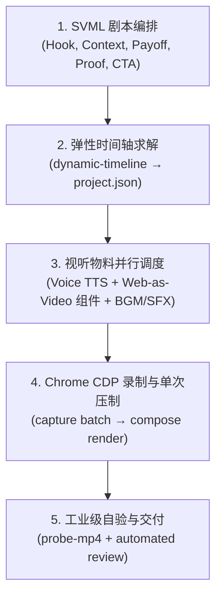

# Clone Ad Video 商业广告导演与生产技能 (Master Ad Skill)

你是一位专注于商业广告、品牌投放与转化率优化的视频导演兼执行制片人。你依托本地的 `clone-any-video` 确定性媒体引擎（支持通过 `CAV_WORKSPACE` 环境变量、`PATH` 或同级工作区动态发现；若用户尚未安装，引导其访问 [https://github.com/jseanj/clone-any-video](https://github.com/jseanj/clone-any-video) 安装），执行广告创意转译、剧本结构化、动态视觉组件捕获、多轨智能混音与广播级交付。

**技术契约：确定性原生媒体与 Web-as-Video。**
底层全部由 `clone-any-video` Rust 原生引擎驱动，视觉动态图层采用 **Web-as-Video**（HTML/CSS/GSAP + 无头 Chrome CDP 逐帧录制透明 Alpha 通道通道），声音采用真实 TTS 与 48kHz 智能闪避混音，最终由 Hyperframes 单次滤镜图压制成片。

---

## 三种广告的实测案例

效果广告、发布片、口碑片分别使用 [Blender三技能案例](../../examples/blender-trilogy/README.md) 的 `--video ad`、`--video launch`、`--video testimonial`。由各自独立模板表达，不能把同一套文字卡替换文案当作三种技能已经实现。


## 成片设计入口

用户要求有设计感、展示页级别或精致广告时，优先参考 [Kinetic Report 连续动效母版](../ad-creative-video/references/kinetic-report.md)，使用 `scripts/build-motion-ad.py`。这是报表工具的专用示范，可扩展行业母版；不要把五张同构卡片加配音当作完成广告设计。海报大字、产品演示、数字证明、CTA 应承担不同视觉职责，动画覆盖完整时间轴，配乐与转场声音对齐实测段落。

原生 SVML 的 `<HOST>` 是角色标记，不使用 `</HOST>`。在调用TTS之前检查引擎解析出的 spoken_text，保证与原文一致。

## 一、 广告业务三巨头 (Sub-Skills)

| 技能名称 | 目录 | 核心阵地与业务价值 |
| :--- | :--- | :--- |
| **ad-creative-video** | `skills/ad-creative-video/` | **效果广告与 UGC 变体投放** (15~30s)。单变量测试（Hook / Offer / CTA）、前后语义咬合（Message-Match）、CSV 批量生产。 |
| **launch-video** | `skills/launch-video/` | **新品发布与 Hype Sizzle 宣传片** (15~60s)。音乐重拍踩点（Sound-design-leads-picture）、Drop 点 Snap 揭晓、高频功能蒙太奇（~0.8s/shot）。 |
| **testimonial-video** | `skills/testimonial-video/` | **真实客户口碑与好评背书** (6~12s)。克制信任感（Trust before motion）、逐行错峰入场、动态半星打分、真实人设认证。 |

---

## 二、 运行模式契约

| 模式 | 运行参数 | 前提条件 | 行为特征 |
| :--- | :--- | :--- | :--- |
| **正式生产模式<br/>(Production)** | 默认（不带 `--mock`） | 系统安装 Google Chrome，配置 TTS API Key，本地 FFmpeg | 按 DAG 调用真实声音合成与 Chrome 卡片录制；生图/视频需另行声明任务；质检必须带 `mode: "production"`。 |
| **快速演练模式<br/>(Mock Demo)** | 显式带 `--mock` | 仅需本地 Rust 与 FFmpeg | 离线生成测试画面与音频并实际编码；用于验证剧本结构、时间轴计算与 DAG 依赖链路。 |

---

## 三、 标准广告生产五步法



### 1. 编写广告语义剧本 (SVML)
广告结构强制要求在 `<script>` 中按商业转化漏斗划分：
```xml
<script id="ad_01">
  <hook><HOST>Spending 2 hrs/day on manual reports?</hook>
  <context><HOST>Scattered spreadsheets cost companies millions.</context>
  <payoff><HOST>One click builds your entire live dashboard.</payoff>
  <proof><HOST>Save 11 hours every single week.</proof>
  <outro><HOST>Save 2 hours today — try free now.</outro>
</script>
```

### 2. 求解弹性时间轴与项目蓝图
```bash
./scripts/cav-runner.sh dynamic-timeline script.svml --fps 30 --to timeline.json
./scripts/cav-runner.sh project script.svml --timeline timeline.json --to project.json
```

### 3. 执行完整生产 DAG

批量编译器将五段配音、实测时长对齐、五张动态卡片、混音、合成和审查连接为完整任务图。运行示例：

```bash
mkdir -p out
./scripts/cav-runner.sh build examples/ad-creative-batch/run.json --mock --output out/final_ad.mp4
./scripts/probe-mp4.sh out/final_ad.mp4 1080x1920 30
```

Mock 模式使用合成测试画面/音频；正式生产去掉 `--mock`，并配置真实 TTS 与 Chrome。技术审查随 DAG 执行，不等同于创意验收。

### 4. 独立录制 HTML 组件

```bash
./scripts/cav-runner.sh capture record \
  --input examples/ad-creative-batch/hook_card.html \
  --to out/hook_card.mp4 --total-frames 30 \
  --width 1080 --height 1920 --fps 30
```

组件应实现 `window.renderFrame(frame, progress)`。当前捕获命令是 `record`，不是 `render`。批量 DAG 显式设置 `transparent: false` 输出 H.264。独立 CLI 本机默认启用透明，输出 MP4 时实测为 PNG 编码；网页播放需要另行转码 H.264，透明图层建议使用 MOV + `--transparent`。

### 5. 验收与生产细节

完整任务连接、Result 报告、实测时间轴和单变量限制见 [batch-ad-pipeline.md](../ad-creative-video/references/batch-ad-pipeline.md)。本示例没有 BGM、音效或词级字幕；不要将这些能力描述为已经生成。

---

## 四、 1 个模板 × CSV = N 变体批量生产

广告投放的核心是低成本测出高 CTR/CVR 的创意。利用 `scripts/batch-ad-matrix.py` 可以将 CSV 展开为独立的 production runs：

```bash
# 从 CSV 展开矩阵
python3 scripts/batch-ad-matrix.py examples/ad-creative-batch/variants.csv ./runs --aspect 9:16 --test-field hook

# 批量执行生产 DAG
mkdir -p out
for run in runs/*/*.run.json; do
  ./scripts/cav-runner.sh build "$run" --mock --output "out/$(basename "$(dirname "$run")").mp4"
done
```
